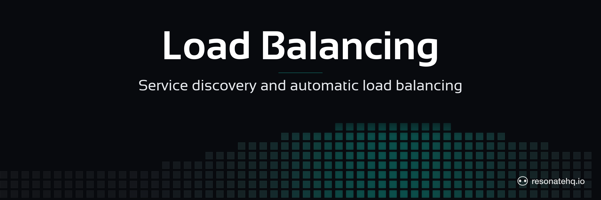

<p align="center">
  <picture>
    <source media="(prefers-color-scheme: dark)" srcset="./assets/banner-dark.png">
    <source media="(prefers-color-scheme: light)" srcset="./assets/banner-light.png">
    
  </picture>
</p>

<p align="center">
  <a href="https://resonatehq.github.io/examples-ci/">
    
  </a>
</p>

# Worker load balancing

**Resonate TypeScript SDK**

This example showcases Resonate's automatic service discovery and load balancing capabilities.

Instructions on [How to run this example](#how-to-run-this-example) are below.


## The problem

A single worker or microservice instance will eventually become overwhelmed if there is too much work sent its way in a short amount of time.

There are generally two ways to solve this:

1. Increase the compute capability for the single worker / microservice.
2. Increase the number of worker / microservice instances.

There is an upper limit to the first option, and it is a single point of failure if there is only ever one instance running.

Therefore, the second option tends to be the desired approach, because in theory you can scale the number of instances indefinitely. However, this introduces another problem: service discovery and load balancing — that is, knowing which worker / application node has the capacity to take more work.

But beyond that, what happens if a worker / microservice instance crashes after starting work and making progress on it.

How does the system know it needs to recover that work somewhere else, and where to recover it?

These are distributed system engineering issues that developers are commonly forced to solve again and again.
And often they are forced to mix messy service discovery, load balancing, and recovery logic into their application or business logic, which makes for a very poor developer experience.

## The solution

Resonate has built-in service discovery, load balancing, and recovery. And it provides the developer with a simple RPC API and target schema to make use of these features.

In your worker / microservice you can just specify the group that it belongs to (`worker.ts`):

<!-- sotto self:worker.ts#worker -->

```typescript
const resonate = new Resonate({
  url: "http://localhost:8001",
  group: "workers",
});
```

Run as many instances of that worker / microservice as you need.

Then, when you need to call a function on that worker / microservice you use Resonate's RPC API, targeting any worker in that group (`client.ts`):

<!-- sotto self:client.ts#client -->

```typescript
await resonate.beginRpc(
  id,
  "computeSomething",
  { id: id, computeCost: computeCost },
  resonate.options({
    target: "poll://any@workers",
  })
);
```

Resonate handles the rest!

You get automatic service discovery, load balancing, and recovery for all the workers in that group.

## About this example

You run several instances of `worker.ts`, which exposes a single function `computeSomething()`. Then you use `client.ts` to start many executions of it.

What to watch for:

- As you invoke more executions, they spread across the running worker instances.
- Kill a worker mid-execution and its in-flight work recovers on another one.

No routing logic in the application — the group name in the worker and the `poll://any@workers` target in the client are the whole configuration.

## How to run this example

This example requires that a Resonate Server is running.
The Resonate Server acts as a Durable Promise store and a message broker.

Run the Resonate Server:

```shell
# install the server if you haven't yet
brew install resonatehq/tap/resonate
# start the server
resonate dev
```

If you don't have brew, you can try [one of these other methods of installation](https://docs.resonatehq.io/operate/server-installation).

Install dependencies:

```shell
bun install
```

Run multiple worker instances.
We recommend running at least 3 instances to get the best demonstration.

```shell
bun run worker.ts
```

Run the client script.
The client script does not block on a result from `computeSomething()`, so you can run it back to back, as many times as needed.
We recommend running it at least a dozen times to get the best demonstration.

```shell
bun run client.ts
```
